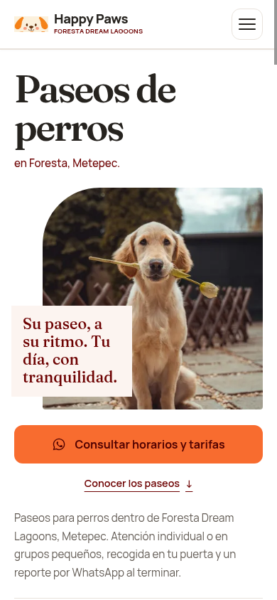
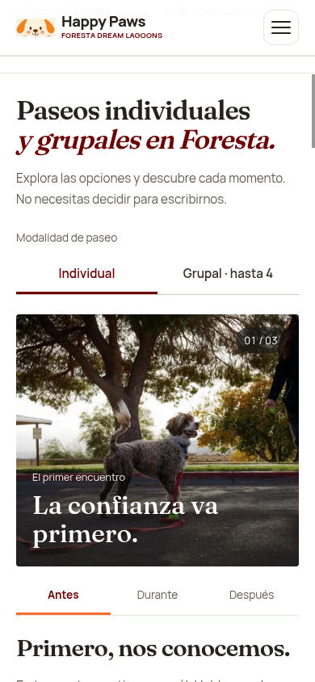
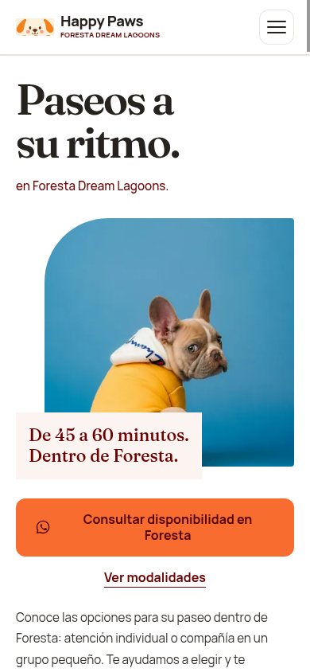
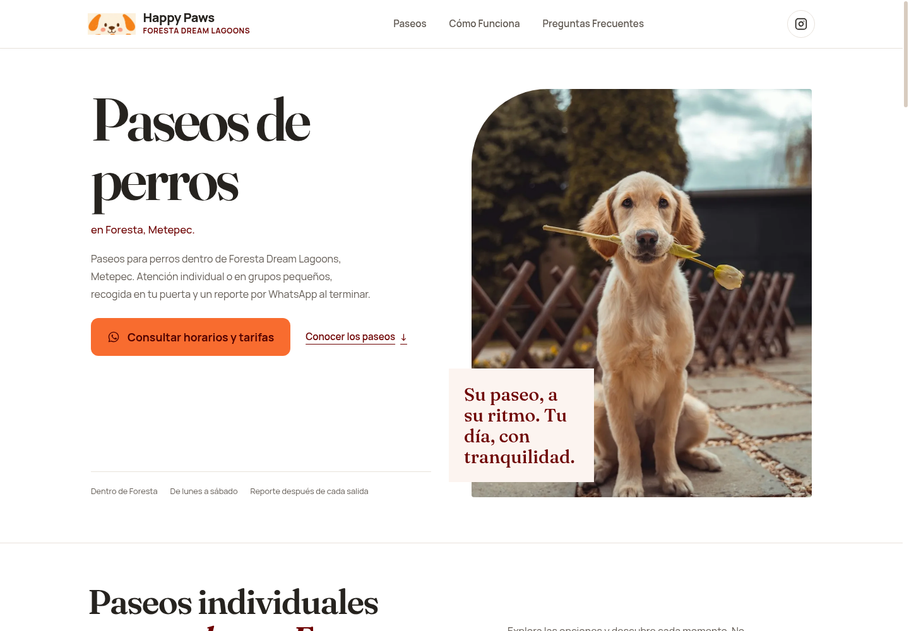
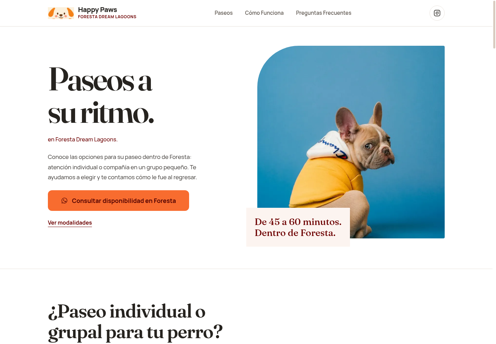

# Happy Paws

Sitio web para un servicio local de paseos caninos en Foresta Dream Lagoons, Metepec, desarrollado como **proyecto freelance remunerado para un cliente real**.

El proyecto presenta las modalidades de paseo, el proceso de atención y los cuidados del servicio en una experiencia responsive, con consultas directas por WhatsApp. Forma parte de mi portafolio de diseño y desarrollo web.

## Vista previa móvil

<table>
  <tr>
    <th>Inicio</th>
    <th>Explorador de paseos</th>
    <th>Detalles del servicio</th>
  </tr>
  <tr>
    <td><a href="docs/screenshots/mobile-inicio.png"></a></td>
    <td><a href="docs/screenshots/mobile-explorador.png"></a></td>
    <td><a href="docs/screenshots/mobile-paseos.png"></a></td>
  </tr>
</table>

Capturas reales del sitio a 390 px de ancho. Haz clic en cada imagen para verla en detalle.

## Vista previa desktop

### Inicio

[](docs/screenshots/desktop-inicio.png)

<details>
  <summary>Ver detalles del servicio en desktop</summary>

[](docs/screenshots/desktop-paseos.png)

</details>

Capturas reales del sitio a 1440 px de ancho. Haz clic en cada imagen para verla en detalle.

## Funcionalidades

- Página principal y página de servicio con paseos individuales y grupales.
- Diseño editorial responsive con fotografías e imágenes optimizadas.
- Explorador interactivo de modalidades y momentos del paseo: antes, durante y después.
- Contacto directo por WhatsApp con mensajes prellenados según la consulta.
- Selector de modalidad, fecha y hora tentativas para preparar la consulta; la reserva se confirma por WhatsApp.
- Preguntas frecuentes, ejemplo ilustrativo del reporte post-paseo y páginas legales.
- SEO local con metadatos sociales, datos estructurados y sitemap.
- Tipografías alojadas localmente y navegación accesible.

## Tecnologías

- **Astro 7** para la generación del sitio estático y la optimización de imágenes.
- **TypeScript**, JavaScript, HTML y CSS para la implementación.
- **Fraunces y Manrope** alojadas localmente para la tipografía, con licencias [SIL OFL de Fraunces](public/fonts/fraunces-OFL.txt) y [Manrope](public/fonts/manrope-OFL.txt).
- **@astrojs/sitemap** para la generación del mapa del sitio.
- **Python unittest y Node.js Test Runner** para las pruebas automatizadas.

## Desarrollo local

Requiere **Node.js 22.23.4 o posterior** y **Python 3** para las pruebas de producción y SEO.

```sh
npm ci
cp .env.example .env
```

Configura el número real de WhatsApp en `.env` antes de iniciar el sitio; el número de ejemplo no permite arrancar ni compilar.

```sh
npm run dev -- --background
```

Para gestionar el servidor en segundo plano: `npx astro dev status`, `npx astro dev logs` y `npx astro dev stop`.

## Verificación y compilación

```sh
npx astro check
npm run build
npm run test:production
npm run test:seo
npm run preview
```

Las pruebas revisan la navegación interna, los recursos, las referencias de accesibilidad, los enlaces de WhatsApp, las selecciones de fecha y hora y el SEO del sitio compilado. La compilación genera el sitio estático en `dist/`.

## Configuración

- `PUBLIC_WHATSAPP_PHONE`: número de contacto obligatorio, en formato internacional y solo dígitos. El sitio rechaza la ausencia de esta variable y el valor de ejemplo.
- `PUBLIC_WHATSAPP_PHONE_DISPLAY`: texto opcional para mostrar el número de contacto.
- `src/config/site.ts`: información del negocio, cobertura, horarios y mensajes de WhatsApp.
- `astro.config.mjs` y `src/config/site.ts`: dominio del sitio; mantén ambos valores alineados al cambiarlo.

## Estructura

```text
src/
  assets/       Fotografías optimizadas por Astro
  components/   Componentes reutilizables e interacciones
  config/       Datos del negocio, preguntas frecuentes y confianza
  layouts/      Plantilla base y metadatos
  lib/          Utilidades de seguimiento de eventos
  pages/        Inicio, paseos, páginas legales y página 404
  styles/       Tokens de diseño y estilos compartidos
public/         Imágenes, fuentes, licencias y archivos estáticos
scripts/        Pruebas de producción, agenda y SEO
docs/screenshots/  Capturas del sitio para el README
```
